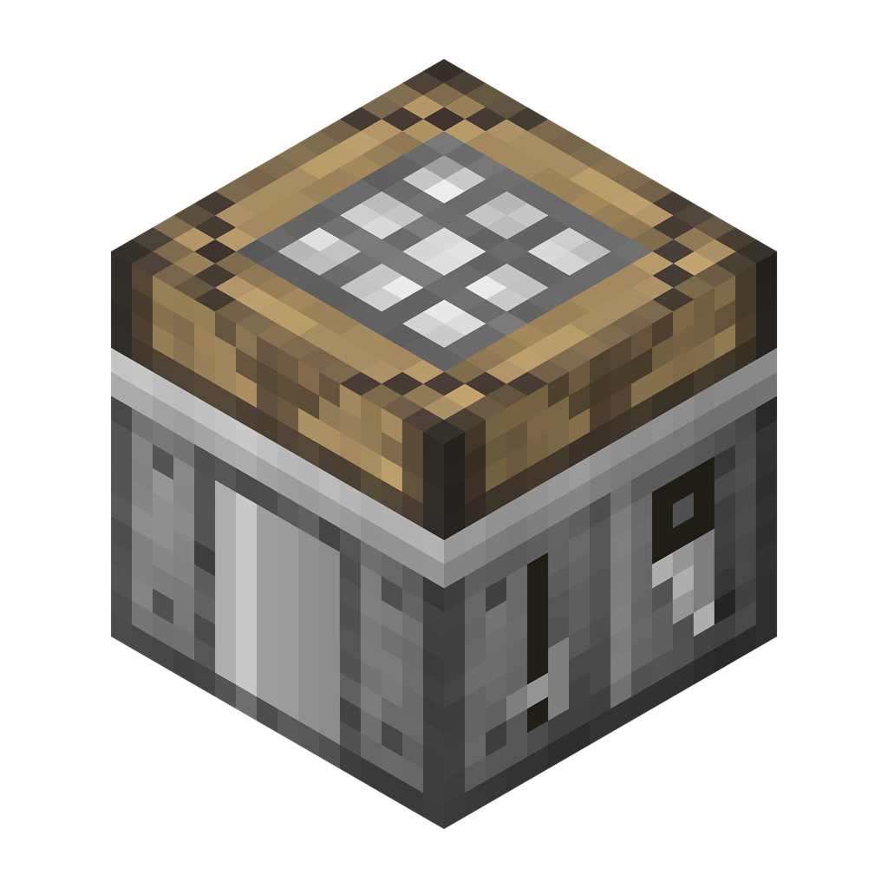

# Minion's Workshop



A single-branch, Stonecutter-managed port of [Engineer's Workshop Reborn](https://github.com/TechReborn/EngineersWorkshopReborn)
for Fabric and NeoForge, continuing Steve's Workshop on modern Minecraft versions.

| Minecraft | Fabric | NeoForge | Game Java |
| --- | --- | --- | --- |
| 1.21.1 | Yes | Yes | 21 |
| 26.1.2 | Yes | Yes | 25 |
| 26.3 | Yes | Yes | 25 |

## Using the workshop

Craft a Workshop Table from a crafting table, two iron ingots, and six planks.
Open it and place a crafting table, furnace, or chest into one of the four tabs
along the top. Left-click an installed tab to show that station's GUI; right-click
its icon to return the block to your cursor. A chest provides 24 storage slots.
Removing or replacing a module does not delete its stored items;
reinstall that module type to access them. Breaking the table drops its real contents,
including installed modules and upgrades, but never its crafting previews or ghost filters.

The icon tabs on the right expand into attached upgrade, transfer, **Item filters**,
and shared-fuel panels. Click an open panel's header again to collapse it; opening another panel
closes the previous one. Hover an icon for its label. The selected station,
your inventory, and the shared fuel buffer stay visible while panels are open.
The **Upgrades** side tab has seven slots for the selected module and eight global
upgrade slots. Global upgrades are accessible even when the selected module is empty.
Craft Blank Upgrades from four iron ingots and redstone, then combine them with the
appropriate ingredient. Recipes are available in the vanilla recipe book.

| Upgrade | Applies to | Limit | Effect |
| --- | --- | --- | --- |
| Auto Crafter | Crafting | 1 | Crafts automatically, reserving one item in each nonempty pattern slot |
| Storage | Crafting | 1 | Adds six ingredient storage slots, also usable for manual crafting |
| Charger | Crafting and smelting | 8 | Stores four instant operations per level while idle |
| Speed | Crafting and smelting | 8 | Increases speed and fuel consumption |
| Queuing | Smelting | 3 | Adds one input queue slot per level |
| Auto Transfer | Global | 1 | Enables automatic transfer to and from adjacent inventories |
| Filter | Global | 1 | Enables ten ghost filters per side and direction |
| Transfer Capacity | Global | 6 | Doubles transfer capacity per level, from 1 to 64 items per second |

Fuel is shared across all four units, with a buffer of 8,000 burn-time units.
Only a whole fuel item whose burn time fits in the buffer is consumed; fuel items
worth more than 8,000 units, such as lava buckets, cannot be burned.
Normal production takes 100 ticks without speed upgrades. Charging takes 400 ticks
and twice the fuel; furnaces consume twice the crafting fuel rate.
Automatic crafting requires extra ingredients beyond the reserved pattern, either
in the grid or in the Storage upgrade's slots. Crafting remainders are returned to
available grid/storage slots or dropped rather than discarded.

Select the hopper side tab to configure the selected module's transfers, or the
coal side tab for shared-fuel transfers. The six slot-sized face buttons form a
cross viewed from the table's front, following the table's placement direction.
They use crafting-table icons, or furnace icons for smelting and shared fuel.
Blue means input, orange output, purple both, and gray disabled. Left-click a face
to cycle those modes; right-click to disable it. Hold Shift to apply the chosen
mode to all six faces. Hover for the relative face, world direction, and mode.
Middle-click a face to select it without changing its mode.

Switching a top tab changes only the module context, not the open side panel.
The icon-only **Auto pull** and **Auto push** buttons control the selected face's
automatic transfers when an Auto Transfer upgrade is installed; Shift-click
applies that setting to all faces. Sides start disabled.

The **Item filters** tab shows separate **Input** and **Output** sections together,
each with ten ghost slots and its own allow/block setting. Its top buttons choose
the selected station or shared fuel, and the world-facing side; right-click the
side selector to go to the previous face. Opening filters from the shared-fuel tab
selects fuel automatically. Filters can allow or block listed items and match exact data components,
item identity, fuzzy item identity (the upstream behavior), or shared item tags.
Click a filter with a carried item to copy it without consuming it; click with an
empty cursor to clear it. Right-click a filter to cycle its matching mode; its
letter badge and tooltip identify the current mode. Transfer settings and filters
survive module/upgrade removal.

JEI is optional. When installed, it reserves the actual animated bounds of every
side tab, including expanded panels, so its ingredient list does not overlap controls.
The filter panel also stays above JEI's footer controls at maximum GUI scale.

## Building

Install **JDK 25** to run Gradle, plus **JDK 21** for the 1.21.1 toolchain.
All six targets share `src/main`; `settings.gradle` defines the Stonecutter matrix,
and loader-specific build scripts use native Fabric Loom and NeoForge ModDev.
No per-version Git branches are required.

```powershell
.\gradlew.bat buildAll
.\gradlew.bat :1.21.1-fabric:build
.\gradlew.bat :26.3-neoforge:runClient
```

On Unix, use `./gradlew` instead. Set `JAVA_HOME` to JDK 25 if another Java version
is selected by your shell. Artifacts are written to `versions\<target>\build\libs`.
Use the loader-specific mod jar, not the `-sources.jar`.
Fabric installations require Fabric API.

The checked-in source is in the `1.21.1-fabric` state. Stonecutter produces the other
five source variants during builds. Resource processing also adapts recipe ingredient
formats, modern item definitions, and resource/data pack metadata.

## Scope and attribution

The port follows the linked archived `master` revision, including its four modules
and nine registered upgrade items (Blank is a crafting component). That Fabric
snapshot did not implement the legacy RF/EU/Tesla/fluid integrations or the additional
upgrade artwork left in its resources; those are not advertised as working features here.
Survival recipes and tag filtering complete missing pieces of that snapshot.

This uses the new `minions_workshop` namespace. It is not an automatic world-save
converter for old `engineersworkshop` blocks; back up old worlds before changing mods.

Original code/concept and textures: Modmuss50, EwyBoy, JorVa, Vswe, and contributors.
Side-configuration layout and automatic-transfer icons follow
[ConvectionCore](https://github.com/Minionade/ConvectionCore/tree/claude/tender-euler-robc80).
Distributed under the MIT license; see `LICENSE` and `NOTICE`.
